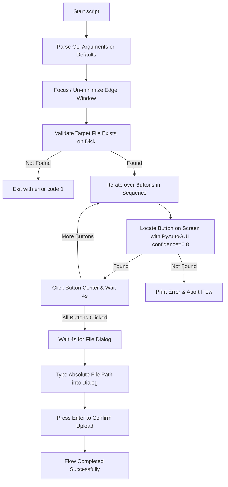

# File-Upload-RPA 🚀

Automated, vision-based file upload script for desktop automation using **PyAutoGUI**, **PyGetWindow**, and Computer Vision.

This script brings Microsoft Edge to the foreground, locates upload button templates on the screen using computer vision (confidence-based image matching), clicks through an arbitrary sequence of buttons (such as dialog triggers, file choose buttons, etc.), and automatically types in the file path to complete the file manager upload flow.

---

## Table of Contents

- [Features](#features)
- [Prerequisites](#prerequisites)
- [Installation](#installation)
- [CLI Reference](#cli-reference)
  - [Positional Arguments](#positional-arguments)
  - [Named Options & Flags](#named-options--flags)
  - [Defaults](#defaults)
- [Usage Examples](#usage-examples)
  - [1. Run with Defaults (Zero Arguments)](#1-run-with-defaults-zero-arguments)
  - [2. Custom Upload File with Default Buttons](#2-custom-upload-file-with-default-buttons)
  - [3. Custom File and Custom Buttons (Positional)](#3-custom-file-and-custom-buttons-positional)
  - [4. Custom Buttons with Default File (Named Flag)](#4-custom-buttons-with-default-file-named-flag)
  - [5. Full Flags (`-f` and `-b`)](#5-full-flags--f-and--b)
  - [6. Single-Button Upload Flow](#6-single-button-upload-flow)
  - [7. Multi-Step Button Wizard (3+ Buttons)](#7-multi-step-button-wizard-3-buttons)
  - [8. View Command-Line Help](#8-view-command-line-help)
- [Python Function API](#python-function-api)
- [How It Works](#how-it-works)
- [Tips for Vision Matching](#tips-for-vision-matching)
- [Troubleshooting](#troubleshooting)
- [License](#license)

---

## Features

- **Window Management:** Automatically detects, un-minimizes, and focuses the target Microsoft Edge window.
- **Vision-Based Template Matching:** Locates buttons on screen with 80% confidence (`confidence=0.8`) using template images.
- **Arbitrary Button Sequences:** Supports 1, 2, or any number of sequential button clicks to navigate complex upload dialogs or wizards.
- **Flexible Argument Parsing:** Accepts paths as positional arguments or named flags (`-f`/`--file`, `-b`/`--buttons`).
- **OS File Dialogue Automation:** Types the absolute file path into the native system dialog and presses Enter to confirm.
- **ANSI Terminal Output:** Styled console logging with color-coded status badges and icons.

---

## Prerequisites

- **Operating System:** Windows (uses `pygetwindow` for window control and native Windows file dialog automation).
- **Python:** Python 3.8 or higher.
- **Screen Resolution:** Recommended Windows Display Scaling set to 100% for consistent template image matching.

---

## Installation

1. **Clone the repository:**
   ```powershell
   git clone https://github.com/ishandutta2007/file-upload-rpa.git
   cd file-upload-rpa
   ```

2. **Create and activate a virtual environment (optional but recommended):**
   ```powershell
   python -m venv .venv
   .\.venv\Scripts\Activate.ps1
   ```

3. **Install dependencies:**
   ```powershell
   pip install -r requirements.txt
   pip install pygetwindow colorama opencv-python pillow
   ```
   > **Note:** `opencv-python` is required for the `confidence=0.8` parameter in PyAutoGUI image matching.

---

## CLI Reference

```
python file-upload-RPA.py [-h] [-f FILE_OPT] [-b BUTTONS_OPT [BUTTONS_OPT ...]] [file_path] [buttons ...]
```

### Positional Arguments

| Argument | Type | Description |
| :--- | :--- | :--- |
| `file_path` | `string` *(optional)* | Path to the local file to upload. |
| `buttons` | `string ...` *(optional)* | One or more paths to button image templates to find and click in order. |

### Named Options & Flags

| Flag | Long Flag | Value | Description |
| :--- | :--- | :--- | :--- |
| `-f` | `--file` | `FILE_PATH` | Path to the local file to upload. |
| `-b` | `--buttons` | `BTN1 [BTN2 ...]` | One or more paths to button template images to click in sequence. |
| `-h` | `--help` | *None* | Show the help message with parameter details and exit. |

### Defaults

| Parameter | Default Value | Description |
| :--- | :--- | :--- |
| **File Path** | `<current_working_directory>\assets\social-preview.gif` | Used if neither `file_path` nor `-f`/`--file` is supplied. |
| **Buttons** | `upload_button1.png`, `upload_button2.png` | Used if neither `buttons` nor `-b`/`--buttons` is supplied. |

---

## Usage Examples

### 1. Run with Defaults (Zero Arguments)
Uses the default target file (`<cwd>\assets\social-preview.gif`) and default button templates (`upload_button1.png`, `upload_button2.png`):

```powershell
python file-upload-RPA.py
```

---

### 2. Custom Upload File with Default Buttons
Specify a custom file path as the first positional argument. The script still uses the default 2-button sequence:

```powershell
python file-upload-RPA.py "C:\Users\username\Pictures\avatar.png"
```

---

### 3. Custom File and Custom Buttons (Positional)
Pass the upload file first, followed by any number of button image templates:

```powershell
python file-upload-RPA.py "C:\path\to\document.pdf" "assets\btn_open.png" "assets\btn_upload.png"
```

---

### 4. Custom Buttons with Default File (Named Flag)
If you want to use the default upload file but supply custom button templates, use the `-b` or `--buttons` flag:

```powershell
python file-upload-RPA.py --buttons "assets\click_upload.png" "assets\confirm_upload.png"
```

---

### 5. Full Flags (`-f` and `-b`)
Explicitly label both the file path and button templates:

```powershell
python file-upload-RPA.py -f "C:\data\report.xlsx" -b "templates\step1.png" "templates\step2.png"
```

---

### 6. Single-Button Upload Flow
Many web applications open the OS file manager with only a single click:

```powershell
# Using positional arguments
python file-upload-RPA.py "C:\images\banner.jpg" "single_upload_button.png"

# Using flags
python file-upload-RPA.py -f "C:\images\banner.jpg" -b "single_upload_button.png"
```

---

### 7. Multi-Step Button Wizard (3+ Buttons)
If your application requires navigating through multiple steps before reaching the file dialog:

```powershell
python file-upload-RPA.py "C:\files\archive.zip" "step1_menu.png" "step2_tab.png" "step3_browse.png"
```

---

### 8. View Command-Line Help
Print the built-in argument parser manual:

```powershell
python file-upload-RPA.py --help
```

Output:
```text
usage: file-upload-RPA.py [-h] [-f FILE_OPT]
                          [-b BUTTONS_OPT [BUTTONS_OPT ...]]
                          [file_path] [buttons ...]

Vision-based file upload automation.

positional arguments:
  file_path             Path to the file to upload (default:
                        <cwd>\assets\social-preview.gif)
  buttons               Paths to button template images to click in sequence
                        (default: upload_button1.png upload_button2.png)

options:
  -h, --help            show this help message and exit
  -f FILE_OPT, --file FILE_OPT
                        Path to the file to upload
  -b BUTTONS_OPT [BUTTONS_OPT ...], --buttons BUTTONS_OPT [BUTTONS_OPT ...]
                        Paths to button template images to click in sequence
```

---

## Python Function API

You can also import and call the automation flow directly in your own Python scripts:

```python
from file_upload_RPA import vision_upload_flow

# Run with defaults
vision_upload_flow()

# Run with custom file and custom list of buttons
vision_upload_flow(
    file_path=r"C:\Users\username\Documents\presentation.pptx",
    buttons=["btn_open.png", "btn_upload.png"]
)
```

---

## How It Works



---

## Tips for Vision Matching

1. **Resolution & Scaling:** Keep Windows display scaling at 100% when capturing template images and running the script.
2. **Crop Tight:** Crop button images tightly around distinct features, excluding large plain white or uniform backgrounds.
3. **Keep Visible:** Ensure the target browser window is completely visible and not covered by other application windows.
4. **Theme Consistency:** If template screenshots were captured in dark mode, the browser must be in dark mode during execution (and vice versa).

---

## Troubleshooting

- **`Error: Target file not found at <path>`:**
  Verify that the path to the file you want to upload exists and is accessible.
- **`Error: Could not find the button <index>.<name> image on the screen.`:**
  - Verify the browser window is currently visible and not obscured.
  - Re-capture the template image snippet on your specific monitor resolution.
  - Make sure `opencv-python` is installed (`pip install opencv-python`).
- **Edge window not focusing:**
  Ensure Microsoft Edge is open with "Edge" in its window title before running the script.

---

## License

This project is licensed under the [MIT License](LICENSE).
