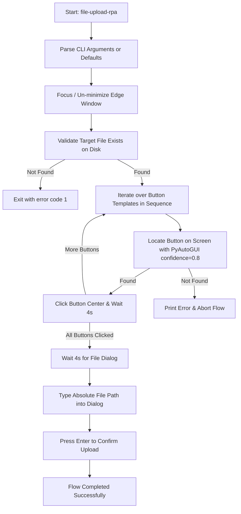
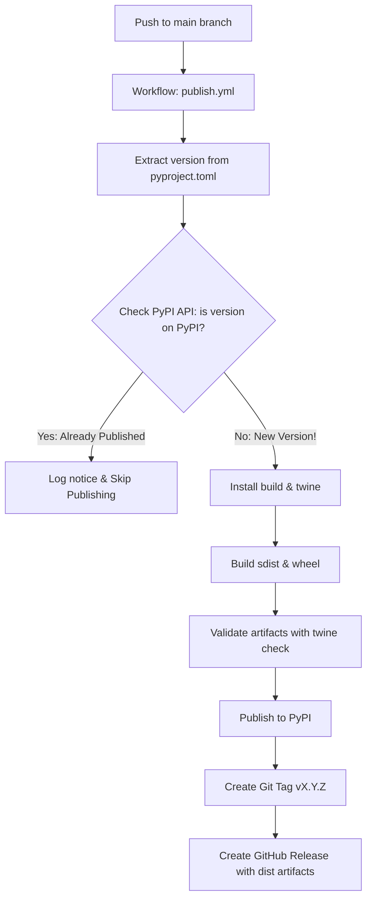

<p align="center">
  
</p>

# File-Upload-RPA 🚀

<p align="center">
  <a href="https://github.com/ishandutta2007/Awesome-Awesome-Awesome"></a><a href="https://discord.gg/jc4xtF58Ve"></a>
  <a href="https://pypi.org/project/file-upload-rpa/"></a>
  <a href="https://pypi.org/project/file-upload-rpa/"></a>
  <a href="https://github.com/ishandutta2007/File-Upload-RPA/actions/workflows/ci.yml"></a>
  <a href="https://github.com/ishandutta2007/File-Upload-RPA/blob/main/LICENSE"></a>
  <a href="https://github.com/astral-sh/ruff"></a>
  <a href="https://github.com/ishandutta2007"></a>
</p>

Automated, vision-based file upload package and CLI tool for desktop RPA using **PyAutoGUI**, **PyGetWindow**, and Computer Vision.

This tool brings Microsoft Edge to the foreground, locates upload button templates on the screen using computer vision (confidence-based template matching), clicks through an arbitrary sequence of buttons (such as dialog triggers, file choose buttons, etc.), and automatically types in the file path to complete the file manager upload flow.

---

## 📑 Table of Contents

- [✨ Features](#features)
- [🏗️ Architecture & Workflow](#architecture--workflow)
- [👤 1. User Guide](#-1-user-guide)
  - [📦 Installation](#installation)
  - [💻 CLI Reference](#cli-reference)
  - [💡 Usage Examples](#usage-examples)
  - [🐍 Python Library API](#python-library-api)
  - [🎯 Tips for Vision Matching](#tips-for-vision-matching)
  - [🔍 Troubleshooting](#troubleshooting)
- [🛠️ 2. Developer & Contributor Guide](#️-2-developer--contributor-guide)
  - [📋 Prerequisites](#prerequisites)
  - [💻 Setting Up Local Development](#setting-up-local-development)
  - [📂 Project Layout](#project-layout)
  - [🧹 Code Quality & Linting](#code-quality--linting)
  - [🧪 Testing Locally](#testing-locally)
  - [🤝 Contributing Flow](#contributing-flow)
- [🚀 3. Package Publisher & DevOps Guide](#-3-package-publisher--devops-guide)
  - [🔄 Automated PyPI Publishing Overview](#automated-pypi-publishing-overview)
  - [⚙️ How Automated Version Publishing Works](#how-automated-version-publishing-works)
  - [🔐 Configuring PyPI Authentication](#configuring-pypi-authentication)
    - [🛡️ Option A: Trusted Publishing via OIDC (Recommended)](#option-a-trusted-publishing-via-oidc-recommended)
    - [🔑 Option B: PyPI API Token via GitHub Secrets](#option-b-pypi-api-token-via-github-secrets)
  - [📝 Step-by-Step Release Process](#step-by-step-release-process)
  - [⚡ Manual Workflow Dispatch](#manual-workflow-dispatch)
  - [🖥️ Manual Local Publishing](#manual-local-publishing)
- [⭐ Star History](#star-history)
- [💖 Support & Community](#support)
- [📄 License](#license)

---

<a id="features"></a>
## ✨ Features

- 🖥️ **CLI Tool:** Runs directly from your terminal as `file-upload-rpa` after installation.
- 🪟 **Window Management:** Automatically detects, un-minimizes, and focuses Microsoft Edge.
- 👁️ **Vision-Based Template Matching:** Locates buttons on screen with 80% confidence (`confidence=0.8`).
- 🔁 **Arbitrary Button Sequences:** Supports 1, 2, or any number of sequential button clicks for complex upload wizards.
- 📦 **Bundled Assets:** Default button templates are packaged inside the wheel so defaults work anywhere on your machine.
- 🎛️ **Flexible Argument Parsing:** Accepts paths as positional arguments or named flags (`-f`/`--file`, `-b`/`--buttons`).
- 📁 **OS File Dialogue Automation:** Automatically types absolute file paths into the native dialog and confirms.
- 🚀 **Continuous Integration & Auto-Publishing:** Full GitHub Actions suite with automatic PyPI deployment on version increment.

---

<a id="architecture--workflow"></a>
## 🏗️ Architecture & Workflow



---

# 👤 1. User Guide

This section is for users who want to install and use `file-upload-rpa` to automate file uploads on their Windows desktop.

<a id="installation"></a>
### 📦 Installation

Install the latest release directly from [PyPI](https://pypi.org/project/file-upload-rpa/):

```powershell
pip install file-upload-rpa
```

Or install the latest development branch directly from GitHub:

```powershell
pip install git+https://github.com/ishandutta2007/file-upload-rpa.git
```

> 💡 **Requirements:** Windows 10/11, Python 3.8+, and Microsoft Edge. Recommended Windows Display Scaling set to 100%.

<a id="cli-reference"></a>
### 💻 CLI Reference

You can invoke the CLI tool in three equivalent ways:

```powershell
# 1. Direct CLI command (recommended)
file-upload-rpa [options] [file_path] [buttons ...]

# 2. Python module runner
python -m file_upload_rpa [options] [file_path] [buttons ...]

# 3. Source script runner
python file-upload-RPA.py [options] [file_path] [buttons ...]
```

#### ⚙️ Arguments & Options

| Option / Argument | Type | Default | Description |
| :--- | :--- | :--- | :--- |
| `file_path` | Positional | `<cwd>\assets\social-preview.gif` | Path to the file to upload. |
| `buttons` | Positional | Bundled `upload_button1.png`, `upload_button2.png` | One or more button template image paths to click in sequence. |
| `-f`, `--file` | Flag | *None* | Explicit flag for the file to upload. |
| `-b`, `--buttons` | Flag | *None* | Explicit flag for one or more button template paths. |
| `-v`, `--version` | Flag | *None* | Display installed package version and exit. |
| `-h`, `--help` | Flag | *None* | Display command-line options and help manual. |

<a id="usage-examples"></a>
### 💡 Usage Examples

#### 🔹 Example 1: Run with Defaults (Zero Arguments)
Uses the default target file (`<cwd>\assets\social-preview.gif`) and default button templates:
```powershell
file-upload-rpa
```

#### 🔹 Example 2: Custom Upload File with Default Buttons
Specify the file path as the first positional argument:
```powershell
file-upload-rpa "C:\Users\username\Pictures\avatar.png"
```

#### 🔹 Example 3: Custom File and Custom Button Sequence (Positional)
Pass the upload file first, followed by any number of button image paths:
```powershell
file-upload-rpa "C:\documents\report.pdf" "assets\step1.png" "assets\step2.png"
```

#### 🔹 Example 4: Custom Buttons with Default File (Named Flag)
Keep the default upload file, but supply custom button templates using `-b`:
```powershell
file-upload-rpa --buttons "assets\click_upload.png" "assets\confirm_upload.png"
```

#### 🔹 Example 5: Full Named Flags (`-f` and `-b`)
Explicitly label both the file path and button templates:
```powershell
file-upload-rpa -f "C:\data\table.xlsx" -b "templates\btn1.png" "templates\btn2.png"
```

#### 🔹 Example 6: Single-Button Flow
For dialogs requiring only a single click before the file chooser opens:
```powershell
file-upload-rpa "C:\images\banner.jpg" "single_button.png"
```

#### 🔹 Example 7: Multi-Step Button Wizard (3+ Buttons)
For multi-step flows navigating through multiple screens:
```powershell
file-upload-rpa "C:\archive.zip" "step1.png" "step2.png" "step3.png" "step4.png"
```

#### 🔹 Example 8: Check Version and Help
```powershell
file-upload-rpa --version
file-upload-rpa --help
```

<a id="python-library-api"></a>
### 🐍 Python Library API

You can also integrate `file-upload-rpa` into your own Python applications:

```python
from file_upload_rpa import vision_upload_flow, focus_edge_window

# 1. Bring Microsoft Edge to the foreground
focus_edge_window()

# 2. Run with defaults
vision_upload_flow()

# 3. Run with custom file and buttons
vision_upload_flow(
    file_path=r"C:\Users\username\Documents\presentation.pptx",
    buttons=["step1.png", "step2.png"],
    focus_window=True
)
```

<a id="tips-for-vision-matching"></a>
### 🎯 Tips for Vision Matching

1. 📏 **Display Scaling:** Set Windows display scaling to **100%** (Settings > Display > Scale) for maximum template recognition accuracy.
2. ✂️ **Crop Tight:** Crop button templates tightly around unique button borders or text, omitting large plain backgrounds.
3. 🪟 **Keep Target Window Unobscured:** Ensure the target window is completely visible and not covered by other windows during automation.
4. 🌓 **Theme Consistency:** If template screenshots were captured in dark mode, the browser must be in dark mode during execution (and vice versa).

<a id="troubleshooting"></a>
### 🔍 Troubleshooting

- ❌ **Target File Not Found:** `Error: Target file not found at <path>`. The path provided does not exist on disk. Check for typos or verify the file path.
- ⚠️ **Button Not Found on Screen:** `Error: Could not find the button <index>.<name> image on the screen.`
  - Verify Microsoft Edge is open and visible on screen.
  - Re-crop your button template image at your current monitor resolution.
  - Verify `opencv-python` is installed (`pip install opencv-python`).
- 🔄 **Edge Window Not Focusing:** Ensure Microsoft Edge is running with "Edge" in its window title before running the script.

---

# 🛠️ 2. Developer & Contributor Guide

This section is for developers who want to set up the codebase locally, run tests, lint, and contribute changes.

<a id="prerequisites"></a>
### 📋 Prerequisites

- 🐍 Python 3.8 or higher (Python 3.11+ recommended).
- 🐙 Git.
- 🪟 Windows environment (required for PyGetWindow and PyAutoGUI GUI automation).

<a id="setting-up-local-development"></a>
### 💻 Setting Up Local Development

1. **Clone the repository:**
   ```powershell
   git clone https://github.com/ishandutta2007/file-upload-rpa.git
   cd file-upload-rpa
   ```

2. **Create and activate a virtual environment:**
   ```powershell
   python -m venv .venv
   .\.venv\Scripts\Activate.ps1
   ```

3. **Install the package in editable mode along with development tools:**
   ```powershell
   python -m pip install --upgrade pip
   pip install -e .
   pip install ruff build twine
   ```

<a id="project-layout"></a>
### 📂 Project Layout

```
file-upload-rpa/
├── .github/
│   └── workflows/
│       ├── ci.yml                 # CI: Linting & multi-version build matrix
│       └── publish.yml            # Auto-publish: PyPI publishing on version increment
├── src/
│   └── file_upload_rpa/
│       ├── __init__.py            # Public package exports
│       ├── __main__.py            # CLI module entry point (`python -m file_upload_rpa`)
│       ├── __version__.py         # Dynamic version resolver
│       ├── cli.py                 # Argument parsing and CLI dispatch
│       ├── uploader.py            # Vision automation engine
│       ├── py.typed               # PEP 561 typing marker
│       └── assets/                # Bundled default template images
│           ├── upload_button1.png
│           └── upload_button2.png
├── file-upload-RPA.py             # Root backward-compatibility wrapper
├── pyproject.toml                 # Package metadata, dependencies, entry points
├── setup.py                       # Setuptools compatibility shim
├── requirements.txt               # Pinned dependencies
├── LICENSE                        # MIT License
└── README.md                      # Documentation
```

<a id="code-quality--linting"></a>
### 🧹 Code Quality & Linting

This project uses [Ruff](https://github.com/astral-sh/ruff) for linting and code formatting:

```powershell
# Run the linter
ruff check src/ file-upload-RPA.py

# Automatically fix linting issues where possible
ruff check --fix src/ file-upload-RPA.py

# Check code formatting
ruff format --check src/ file-upload-RPA.py

# Format code
ruff format src/ file-upload-RPA.py
```

<a id="testing-locally"></a>
### 🧪 Testing Locally

1. **Verify CLI binary in editable mode:**
   ```powershell
   file-upload-rpa --help
   file-upload-rpa --version
   ```

2. **Verify Python module execution:**
   ```powershell
   python -m file_upload_rpa --version
   ```

3. **Verify distribution packaging:**
   ```powershell
   python -m build
   twine check --strict dist/*
   ```

<a id="contributing-flow"></a>
### 🤝 Contributing Flow

1. Fork the repository and create your feature branch:
   ```powershell
   git checkout -b feature/my-new-feature
   ```
2. Make your changes and ensure `ruff check` and `ruff format` pass.
3. Build and validate distributions locally using `python -m build && twine check --strict dist/*`.
4. Commit your changes with descriptive messages:
   ```powershell
   git commit -m "Add feature X"
   ```
5. Push to your branch and submit a Pull Request to `main`.
6. GitHub Actions CI will automatically run the lint and build validation matrix across Python 3.8 - 3.12.

---

# 🚀 3. Package Publisher & DevOps Guide

This section is for maintainers and DevOps engineers managing PyPI publishing and version releases.

<a id="automated-pypi-publishing-overview"></a>
### 🔄 Automated PyPI Publishing Overview

The repository is configured with an automated GitHub Actions pipeline in [`.github/workflows/publish.yml`](.github/workflows/publish.yml).

Whenever changes are pushed to `main`, the workflow automatically:
1. **Reads the version** defined in [`pyproject.toml`](pyproject.toml).
2. **Queries the PyPI JSON API** to check if that exact version is already published on PyPI.
3. **If the version is NEW (incremented):**
   - Automatically builds the Source Distribution (`.tar.gz`) and Universal Wheel (`.whl`).
   - Validates package integrity using `twine check --strict`.
   - Publishes the package to [PyPI](https://pypi.org/project/file-upload-rpa/).
   - Generates a Git tag (e.g. `v0.1.1`) and creates an official **GitHub Release** with distribution assets attached.
4. **If the version is ALREADY on PyPI:**
   - The workflow logs a notice and safely skips publishing without failing the workflow.



---

<a id="how-automated-version-publishing-works"></a>
### ⚙️ How Automated Version Publishing Works

**Single Source of Truth:** The version in [`pyproject.toml`](pyproject.toml) controls releases:

```toml
[project]
name = "file-upload-rpa"
version = "0.1.1"   # <-- Increment this value to trigger publication
```

Because [`src/file_upload_rpa/__version__.py`](src/file_upload_rpa/__version__.py) dynamically references package metadata, you **only** need to increment the version in `pyproject.toml`!

---

<a id="configuring-pypi-authentication"></a>
### 🔐 Configuring PyPI Authentication

You can authenticate with PyPI using either **Trusted Publishing (OIDC)** (recommended by PyPA) or a **PyPI API Token**.

<a id="option-a-trusted-publishing-via-oidc-recommended"></a>
#### 🛡️ Option A: Trusted Publishing via OIDC (Recommended)
PyPI Trusted Publishing allows GitHub Actions to publish without storing long-lived API tokens or passwords:

1. Log in to [pypi.org](https://pypi.org/) and go to your account settings.
2. If the project already exists on PyPI:
   - Navigate to **Your Projects** > **file-upload-rpa** > **Publishing**.
   - Under **Add a publisher**, choose **GitHub**.
3. If this is the **first publication** (project not yet created on PyPI):
   - Go to [PyPI Account Settings > Publishing](https://pypi.org/manage/account/publishing/).
   - Under **Add a pending publisher**, specify:
     - **PyPI Project Name:** `file-upload-rpa`
     - **Owner:** `ishandutta2007`
     - **Repository name:** `File-Upload-RPA` (match exact GitHub casing)
     - **Workflow name:** `publish.yml`
     - **Environment name:** *(leave completely blank)*
4. Click **Add publisher**. No GitHub Secrets are needed! The workflow automatically uses GitHub's OpenID Connect (`id-token: write`).

<a id="option-b-pypi-api-token-via-github-secrets"></a>
#### 🔑 Option B: PyPI API Token via GitHub Secrets
If you prefer traditional API tokens:

1. Log in to [pypi.org](https://pypi.org/) and go to **Account settings** > **API tokens**.
2. Click **Add API token**, give it a name (e.g., `file-upload-rpa-github-actions`), and set the scope to **Entire account** (for first release) or **Project: file-upload-rpa** (for existing releases).
3. Copy the token (starts with `pypi-...`).
4. Go to your GitHub repository: **Settings** > **Secrets and variables** > **Actions**.
5. Click **New repository secret**:
   - **Name:** `PYPI_API_TOKEN`
   - **Value:** Paste your PyPI token.
6. Click **Add secret**. The workflow detects `PYPI_API_TOKEN` and uses it automatically.

---

<a id="step-by-step-release-process"></a>
### 📝 Step-by-Step Release Process

To release a new version of `file-upload-rpa`:

1. **Increment the version** in [`pyproject.toml`](pyproject.toml):
   ```toml
   [project]
   name = "file-upload-rpa"
   version = "0.1.1" # Change from 0.1.0 to 0.1.1
   ```

2. **Commit and push to `main`:**
   ```powershell
   git add pyproject.toml
   git commit -m "Bump version to 0.1.1"
   git push origin main
   ```

3. **Monitor the workflow:**
   - Go to the **Actions** tab in your GitHub repository.
   - Click the **Publish to PyPI** workflow run.
   - The workflow detects the new version, builds the wheel and sdist, uploads to PyPI, tags `v0.1.1`, and creates a GitHub Release!

4. **Verify on PyPI:**
   - Visit https://pypi.org/project/file-upload-rpa/ to see the newly published version.

---

<a id="manual-workflow-dispatch"></a>
### ⚡ Manual Workflow Dispatch

You can also trigger a build manually from the GitHub UI:

1. Navigate to **Actions** > **Publish to PyPI**.
2. Click **Run workflow**.
3. (Optional) Check **Force publish even if version already exists on PyPI** if you want to bypass the duplicate version check.
4. Click **Run workflow**.

---

<a id="manual-local-publishing"></a>
### 🖥️ Manual Local Publishing

If you ever need to publish manually from your local machine:

1. **Install build tools:**
   ```powershell
   pip install build twine
   ```

2. **Clean previous artifacts and build:**
   ```powershell
   Remove-Item -Recurse -Force dist, build
   python -m build
   ```

3. **Validate distributions:**
   ```powershell
   twine check --strict dist/*
   ```

4. **Upload to TestPyPI (optional verification):**
   ```powershell
   twine upload --repository testpypi dist/*
   ```

5. **Upload to PyPI:**
   ```powershell
   twine upload dist/*
   ```

---

<a id="star-history"></a>
##  Star History

[](https://star-history.dera.page/#ishandutta2007/file-upload-rpa&type=date&legend=top-left)

---

<a id="support"></a>
## 💖 Support & Community

Thank you so much for exploring and using **File-Upload-RPA**! 🙏

If this project made your automation easier, saved you time, or helped streamline your desktop workflows, please consider showing your support:

- ⭐ **Star this repository** on GitHub to help boost visibility and reach more developers.
- 🍴 **Fork & Contribute** bug fixes, new features, or custom template ideas.
- 📢 **Share** with your network, team, or developer communities.
- ☕ **Buy me a coffee / Sponsor**: If you'd like to support ongoing maintenance and new features, consider sponsoring on GitHub:

  <a href="https://github.com/sponsors/ishandutta2007"></a>

  👉 Visit the [GitHub Sponsor Dashboard](https://github.com/sponsors/ishandutta2007) to support!

---

<a id="license"></a>
## 📄 License

This project is licensed under the [MIT License](LICENSE).
